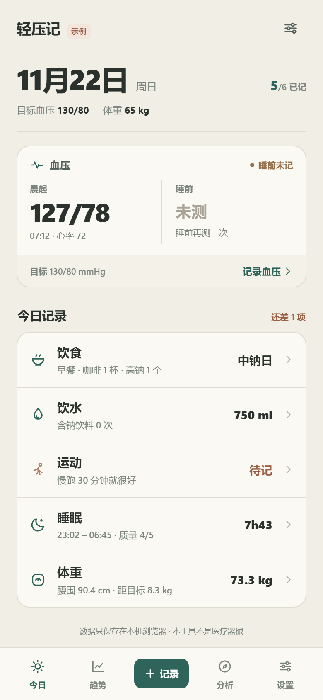

# PressLight · 轻压记（移动端网页版）

根据 `设计文档.md` 实现的个人健康记录网页，移动端优先，可直接在手机浏览器中使用。



> 这是一个个人自用的记录工具，不是医疗器械，不提供诊断、治疗或用药建议。目标血压 130/80 请以医生确认值为准。

## 打开方式

最简单：双击 `index.html`，用浏览器打开即可。

也可以在本目录启动一个本地静态服务（手机和电脑在同一局域网时可访问）：

```bash
python -m http.server 8000
```

然后打开 <http://localhost:8000>。手机访问时把 `localhost` 换成电脑的局域网 IP。

## 页面与功能

底部 5 个入口：今日、趋势、记录、分析、设置。

- **今日**：上方是血压摘要，下面是饮食、饮水、运动、睡眠、体重记录清单；点任意一行即可补记。顶部显示今日完成度，未记项目用陶土色标出。
- **记录**：底部中间的「＋ 记录」按钮，快速录入血压、一餐、饮水、咖啡、慢跑、睡眠、体重腰围、每日快评。
- **趋势**：近 7 天 / 近 30 天的血压、体重、腰围折线图；血压可切换收缩压/舒张压，带目标线；附本周报告。
- **分析**：高钠日、睡眠不足、慢跑、咖啡时间与次日晨压的平均差对比，以及体重下降 2 kg 节点前后的晨压变化。少于 7 天样本显示「样本不足」。
- **设置**：目标血压/体重、提醒时间、用药记录开关、记录明细（可编辑/删除）、常吃食物库、CSV/JSON 导出、JSON 导入恢复、清空数据。示例数据入口放在设置底部。

记血压只展示核心字段，测量条件、症状和备注收进「补充信息」，需要时再展开。记一餐分为「快捷组合」和「自选食物」两个页签，选中食物和份数始终在上方可见，避免长列表来回找。

饮食支持早餐 A/B/C、午餐、晚餐、水果快捷组合，以及 16 种常吃食物的钠/钾标签。睡眠、咖啡会按规则自动打标签。

## 数据说明

- 所有数据保存在浏览器的 `localStorage`，键名为 `presslight.state.v1`，不会上传。
- 换浏览器、清理浏览器数据或卸载应用会丢失记录，请定期在设置中导出 JSON 备份。
- 导出的 CSV 带 UTF-8 BOM，可直接用 Excel/WPS 打开。
- 导入 JSON 会覆盖当前记录。
- 本网页版不会主动推送提醒通知，设置里的提醒时间仅作保存；需要系统提醒请使用手机自带闹钟。

## 示例数据

首次打开可选「载入示例数据」快速预览；也可以访问：

- `index.html?demo=1`：直接载入示例数据。
- `index.html?blank=1`：从空白数据开始。

示例数据只用于预览，随时可以在「设置 → 清空数据」中删除。

## 文件

| 文件 | 说明 |
|---|---|
| `index.html` | 页面结构、图标、底部导航、记录面板 |
| `styles.css` | 暖纸色底、单一墨绿强调色、粗体排版、图表与底部弹层样式 |
| `app.js` | 数据模型、本地存储、记录表单、趋势图、分析、导出 |
| `设计文档.md` | 原始需求与原型设计文档 |

无外部字体、图片、CDN 或构建步骤，断网也能使用。

## 说明

- 目标值、热量和钠/钾标签均为估算或预设，只用于观察趋势，不作精确营养或医疗计算。
- 页面文案避免诊断性结论，出现持续偏高或头晕、胸闷等不适时，请及时就医评估。
- 当前为网页原型，未启用多用户、云端同步、微信小程序能力。
